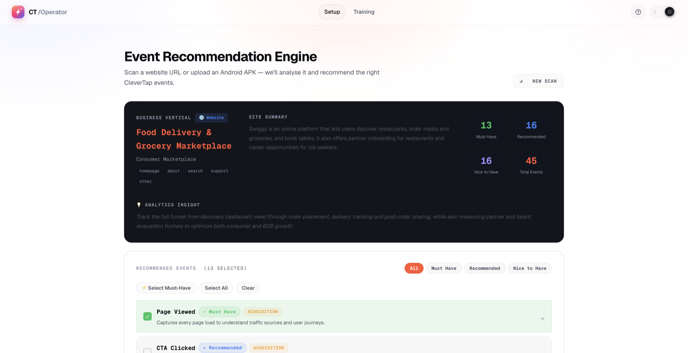
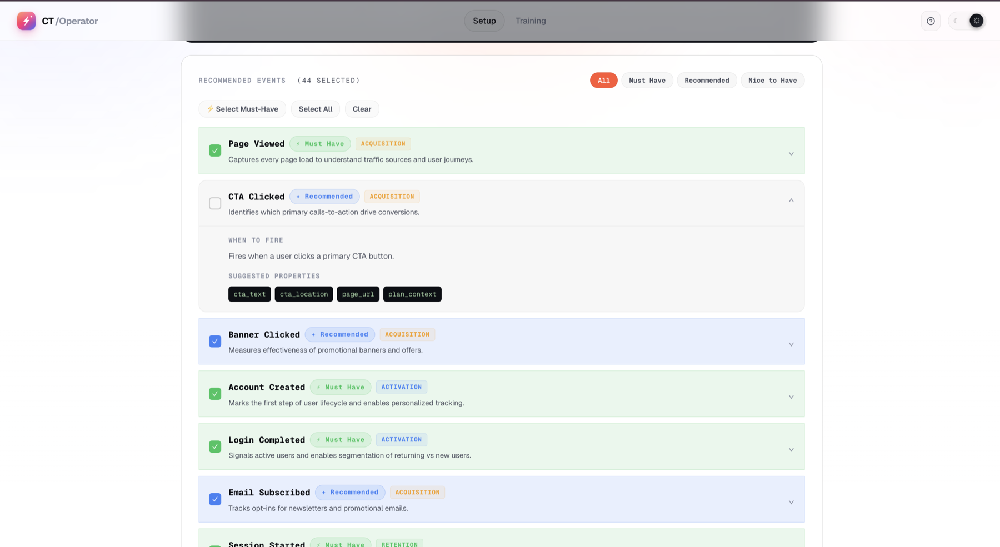
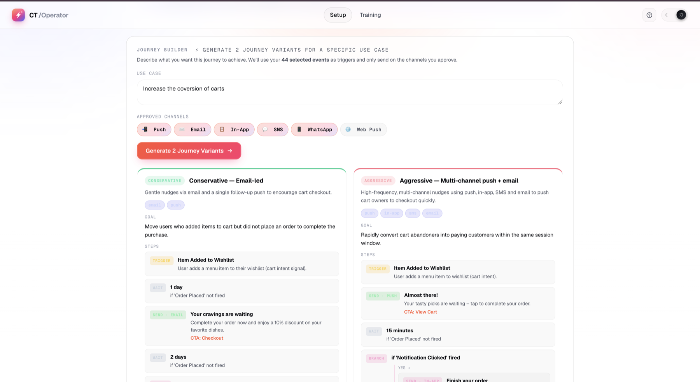
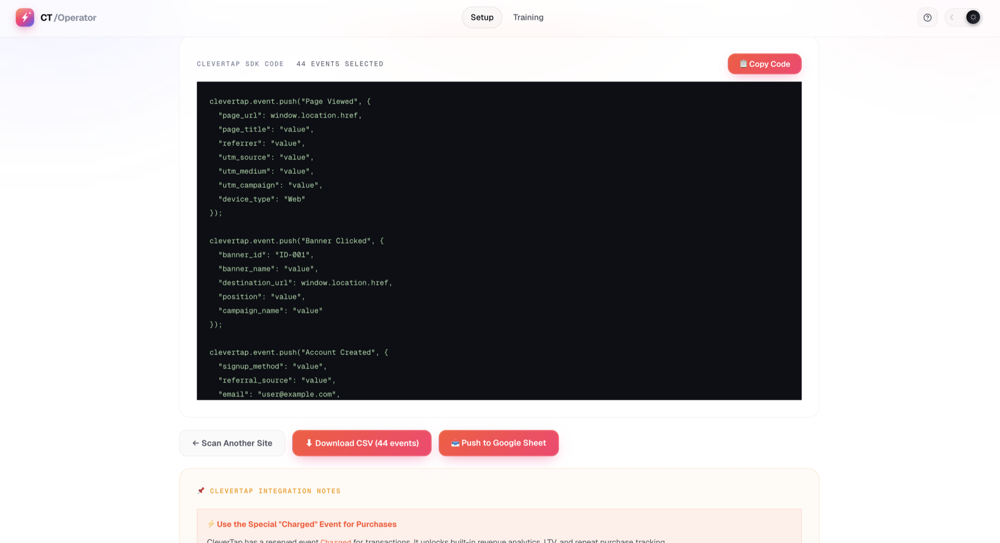
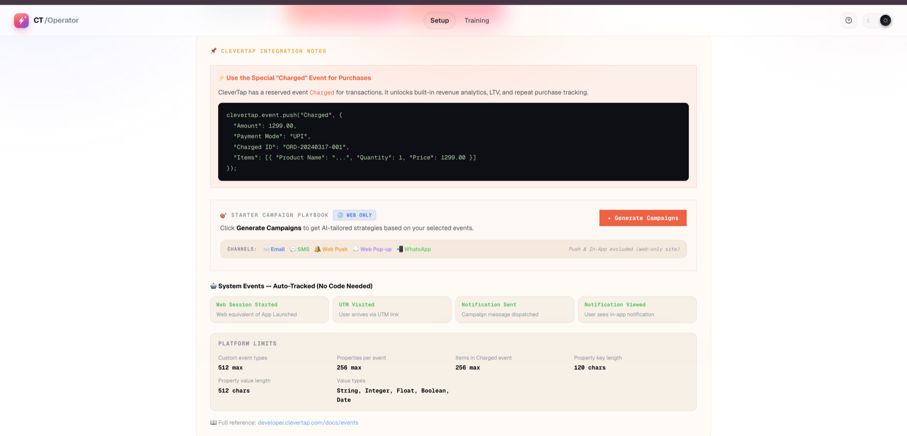

<div align="center">

# ⚡ Event Recommendation Engine

**Scan a website or upload an Android APK — get the right CleverTap events, SDK code, journeys and campaigns in minutes.**




</div>

---

## What it does

1. **Scan** a website (Puppeteer crawl, up to 8 pages) **or** an Android **APK** (static analysis, no Java/apktool needed).
2. **Detect** the business vertical (e.g. *Digital Wallet and Payment Services*) and an app summary.
3. **Recommend events** — each with a priority (**Must Have / Recommended / Nice to Have**), a lifecycle category (Acquisition, Activation, Retention, Revenue, Referral…), a reason, and suggested properties.
4. **Let you select** events (default target ~47 for websites, ~22 for APKs; configurable) and then generate:
   - **CleverTap SDK code** for the selected events (Android / Kotlin / Java, or web `clevertap.event.push`)
   - **Journeys** — 2 variants (Conservative / Aggressive) for a use case you describe, using your selected events as triggers and only the channels you approve (Push, Email, In-App, SMS, WhatsApp, Web Push)
   - **Starter campaign playbook** — AI campaign strategies per channel
5. **Export** — download CSV or push the events to a Google Sheet.

For APKs the results page also shows: package name, screens, activities, permissions, detected SDKs, deep links, features inferred from permissions, and an analytics insight.

The page also includes static CleverTap integration notes (the reserved `Charged` event, auto-tracked system events, platform limits).

---

## 📸 See it in action

Below is a real scan of a food-delivery website. Every screen is produced by the app itself. A printable version is in [`docs/Sample-Output.pdf`](docs/Sample-Output.pdf).

### 1. Understands the business
It crawls the site, infers the **business vertical**, writes a summary and an analytics insight, and sorts the recommendations into **Must Have / Recommended / Nice to Have** (see the banner above).

### 2. Explains every event
Each event comes with a priority, a lifecycle category (Acquisition, Activation, Retention, Revenue, Referral), a reason, **when to fire it** and **suggested properties**. Pick the ones you want, or use *Select Must-Have* / *Select All*.



### 3. Builds journeys from your events
Describe a goal, approve the channels (Push, Email, In-App, SMS, WhatsApp, Web Push) and get **two journey variants** — *Conservative* and *Aggressive* — with triggers, waits, sends and branches.



### 4. Generates ready-to-paste SDK code and exports
Copy the CleverTap SDK code for the events you selected, download them as **CSV**, or push them straight to a **Google Sheet**.



### 5. Adds the CleverTap know-how
Integration notes (such as the reserved `Charged` event for revenue and LTV), the system events CleverTap tracks automatically, and the platform limits to design around.



> 💡 The page also has a **Starter Campaign Playbook**: click *Generate Campaigns* to get AI-written strategies (trigger, timed message sequence, target segment and KPIs) tailored to the events you selected and to the channels that fit your site. APK scans additionally show the package, screens, permissions, SDKs, deep links and inferred features.

---|---|---|
| Page Viewed | Must Have | Acquisition |
| Account Created, Login Completed | Must Have | Activation |
| Session Started, Restaurant Viewed, Delivery Completed | Must Have | Retention |
| Gold Membership Subscribed, Charged, Order Placed | Must Have | Revenue |
| Referral Link Shared | Must Have | Referral |
| CTA Clicked, Banner Clicked, Email Subscribed | Recommended | Acquisition / Activation |
| Checkout Started, Coupon Applied, Gift Card Purchased | Recommended | Revenue |
| Plan a Party Created, Veg Mode Enabled, Hyperpure Order Placed | Nice to Have | Retention / Revenue |

**Journey Builder** — enter a use case (e.g. *reduce cart abandonment within 24 hours*), tick the approved channels (Push, Email, In-App, SMS, WhatsApp, Web Push) and click *Generate 2 Journey Variants*. Your selected events are used as triggers.

**CleverTap SDK Code** for the selected events (Web shown; Android/Kotlin/Java for APKs), with a *Copy Code* button:

```javascript
clevertap.event.push("Order Placed", {
  "order_id": "ID-001",
  "order_total": "value",
  "items_count": 1,
  "restaurant_id": "ID-001",
  "delivery_type": "value",
  "payment_method": "value",
  "coupon_code": "value"
});

// CleverTap special Charged event
clevertap.event.push("Charged", {
  "Amount": 299.00,
  "Payment Mode": "UPI",
  "Charged ID": "ORD-001",
  "Items": [{ "Product Name": "...", "Quantity": 1, "Price": 299.00 }]
});
```

**Export:** *Download CSV* (selected events) and *Push to Google Sheet*.

**Integration notes:** how to use the reserved `Charged` event for purchases and revenue/LTV analytics.

**Starter Campaign Playbook** — click *Generate Campaigns* (or *Regenerate*) to get 5 AI-written strategies for the detected vertical, based on your selected events. Channels are chosen to fit the target (Email, SMS, Web Push, Web Pop-up, WhatsApp for a website; Push and In-App are excluded for web-only sites). Each campaign has:
- a **trigger** (e.g. `Account Created`, or `Order Placed AND NOT Charged within 30 minutes`)
- a **message sequence** with delays and channels (e.g. +15 min Email welcome with a first-order code, then +24 h WhatsApp nudge)
- a **target segment** and **KPIs** (e.g. first-order conversion rate, cart recovery rate, re-activation rate)
- a tip to personalise copy with CleverTap Liquid tags and build the sequence in *Dashboard → Campaigns → Journeys*

**System events (auto-tracked, no code needed):** Web Session Started, UTM Visited, Notification Sent, Notification Viewed (for APKs: App Launched, App Installed, App Uninstalled, App Version Changed, Push Impressions, Notification Clicked).

**Platform limits:** 512 custom event types · 256 properties per event · 256 items in a Charged event · 120-char property keys · 512-char property values · value types String, Integer, Float, Boolean, Date.

For an **APK scan** the header instead shows package name, screens, activities, permissions, detected SDKs, deep links and inferred features (see "What it does").

---

## Architecture

```
Browser (React dashboard, port 3000)
        │  proxy → /api
        ▼
Backend (Node.js / Express, port 4000)
   ├── scanner.js            Puppeteer multi-page website analyser (24 h result cache)
   ├── apkscanner.js         APK analyser (adm-zip: manifest, DEX strings, resources)
   ├── training/             BM25 retrieval over a trained corpus of past apps
   ├── journeyBuilder.js     Journey variants
   ├── campaignGenerator.js  Campaign playbook
   └── googleSheets.js       Push events to Google Sheets (Apps Script web app)
        │
        ▼
AI provider (Anthropic Claude / Groq / Gemini / OpenAI)   +   CleverTap Upload API
```

### How an APK scan works
1. Open the APK as a ZIP and extract package name, activities, permissions, deep-link schemes, string resources and the DEX string pool.
2. Optionally enrich with Play Store lookup.
3. Retrieve similar apps from the **training corpus** (BM25) as few-shot context.
4. Ask the AI for events, then verify them against evidence in the APK.
5. Return the same result shape as a website scan, so the same UI renders both.

### How a website scan works
Puppeteer loads the homepage, discovers internal links, crawls up to 8 key pages (product, cart, checkout, login, search…), merges signals (headings, nav, CTAs, forms, JSON-LD, body text), and sends them to the AI with an event-library reference. Hard cap: 3 minutes per scan.

### AI provider selection
- **APK scan:** Anthropic Claude if `ANTHROPIC_API_KEY` is set (override with `AI_PROVIDER=groq|gemini`), otherwise Gemini or Groq.
- **Website scan / journeys:** Groq → Gemini → OpenAI by env-var presence (website scan also supports Anthropic).
- **Campaigns:** Groq, or Anthropic if no Groq key.
- Default Groq model is `llama-3.3-70b-versatile` (override with `GROQ_MODEL`).

---

## Project structure

```
backend/
  server.js, routes.js          Express app + API routes
  scanner.js, apkscanner.js     Website / APK analysers
  journeyBuilder.js, campaignGenerator.js, googleSheets.js
  training/                     Retriever, store, sheet validator, corpus.json
frontend/
  src/App.js                    Router + sidebar (Setup, Training)
  src/pages/Wizard.jsx          Scan (URL/APK) → results → journeys/SDK code/export
  src/pages/CampaignSuggestions.jsx
  src/pages/TrainingAdmin.jsx   Upload APK + event sheet to train the engine
Event-Recommendation-Engine-How-It-Works.pdf   Full explanation of how the project works
```

---

## Quick start

**Prerequisites:** Node.js 18+, npm 9+, at least one AI API key. Puppeteer downloads Chromium (~300 MB) on install.

```bash
# Backend
cd backend
cp .env.example .env      # then add your AI key(s)
npm install
npm start                 # http://localhost:4000  (health: /health)

# Frontend (second terminal)
cd frontend
npm install
npm start                 # http://localhost:3000  (proxies /api to :4000)
```

---

## Environment variables (`backend/.env`)

| Variable | Description |
|---|---|
| `PORT` | Backend port (default `4000`) |
| `ANTHROPIC_API_KEY` | Claude key (preferred for APK scans) |
| `GROQ_API_KEY` / `GROQ_MODEL` | Groq key / model override |
| `GEMINI_API_KEY` / `GEMINI_MODEL` | Gemini key / model override |
| `OPENAI_API_KEY` / `OPENAI_MODEL` | OpenAI key / model override (journeys) |
| `AI_PROVIDER` | Force `groq` or `gemini` for APK scans |
| `TRAINER_PASSCODE` | Passcode protecting the Training page and `/api/train*` |
| `APPS_SCRIPT_URL` | Google Apps Script web-app URL for the Sheets export |
| `SHARED_SECRET` | Secret sent to the Google Sheets Apps Script |
| `CHROME_PATH` / `PUPPETEER_EXECUTABLE_PATH` | Custom Chrome/Chromium path |
| `REACT_APP_API_URL` | (frontend) backend URL when not using the dev proxy |

Never commit `.env`.

---

## API

| Method & path | Purpose |
|---|---|
| `POST /api/scan` | Scan a website. Body: `{ url, eventCount? }` (10–80, default 47) |
| `POST /api/scan-apk` | Scan an APK. `multipart/form-data`, field `apk` (up to 500 MB), optional `event_count` (default 22) |
| `POST /api/generate-journeys` | 2 journey variants from a use case + selected events + approved channels |
| `POST /api/campaigns` | Campaign playbook. Body: `{ scanResult, selectedEvents }` |
| `POST /api/push-to-sheet` | Push events to Google Sheets |
| `POST /api/train` | Add an APK + event sheet to the training corpus (trainer passcode) |
| `GET/DELETE /api/training…` | List, inspect, stats, delete training entries (trainer passcode) |
| `GET /health` | Health check |

```bash
curl -X POST http://localhost:4000/api/scan \
  -H "Content-Type: application/json" \
  -d '{ "url": "https://example-shop.com" }'

curl -X POST http://localhost:4000/api/scan-apk -F "apk=@app.apk"
```

---

## Training

The **Training** page lets a trainer (passcode-protected) upload an APK plus its approved event sheet. These are stored in `backend/training/data/corpus.json` and retrieved (BM25) at scan time to make recommendations for similar apps more accurate.

---

## Troubleshooting

- **"Groq error: The model `llama-3.3-70b-versatile` does not exist or you do not have access to it"** — your Groq key/org doesn't have that model. Set `GROQ_MODEL` to one you can access, or use another provider key.
- **Website scan fails to launch** — set `CHROME_PATH` to your Chrome/Chromium binary.
- **Large APK upload rejected** — limit is 500 MB.

---

## Deployment

- Backend: set `PORT`; Puppeteer needs a system Chromium (`PUPPETEER_EXECUTABLE_PATH`).
- Frontend: `npm run build`, serve `build/`, and set `REACT_APP_API_URL` to the deployed backend.
